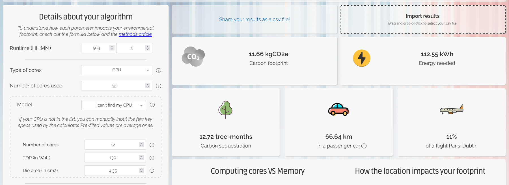

# 1. Mesurer l’impact environnemental du Calcul Haute Performance (HPC)

## 1.1. simulation de physique des particules

### 1. En supposant la puissance moyenne d’un CPU Xeon E5-2680, capable d’exécuter 24 threads sur 12 cœurs, et les moyennes mondiales de PUE et CI, calculer l’empreinte carbone de l’étude

$E = t \times ((n_c \times P_c \times u_c) + (n_m \times P_m)) \times PUE \times 0.001$

- $t = 504 \text{ h}$
- $n_c \text{ (nombre de coeur)} = 12$
- $u_c = 1$
- $P_c = \frac{130}{12} = 10.83$
- $n_m \text{ (taille de la mémoire)} = 10 \text{ (Go)}$
- $P_m = 0.3725$
- $PUE = 1.67$

$E = 504 \times ((12 \times 10.83 \times 1) + (10 \times 0.3725)) \times 1.67 \times 0.001 = 112.52 \text{ kWh}$

$C = E \times CI$

- $E = 112.52 \text{ kWh}$
- $CI = 103.61 \frac{g}{kWh}$

$C = \frac{112.52 \text{ kWh} \times 103.61 \text{ g}}{1 \text{ kWh}} = 11 \text{ } 658.1972 \text{ g} \approx 11.66 \text{ kg}$

### 2. Vérifier votre calcul avec le site Green Algorithms.

On tombe pile poile sur le bon résultat.

### 3. On suppose que 11 niveaux d’énergie différents sont testés. Comment intégrer cette information dans le calcul d’impact ?

Pour cela on va simplement repartire du resultat de l'empreinte carbon ($C = 11.66 \text{ kg}$) et on le multiplie par le coefficient d'échelle pragmatique ($PSF = 11$).

$C_{totale} = C \times PSF = 11.66 \text{ kg} \times 11 = 128.26 \text{ kg}$

### 4. Combien de temps faudrait-il à un arbre adulte pour absorber cette quantité de $CO_2$ ?

Pour un $PSF = 1$ un arbre prend $3$ mois pour absorber $11.66 \text{ kg}$.

Pour un $PSF = 11$ un arbre prendra $3 \text{ mois} \times 11 = 33 \text{ mois}$ pour absorber $128.26 \text{ kg}$ de $CO_2$.

