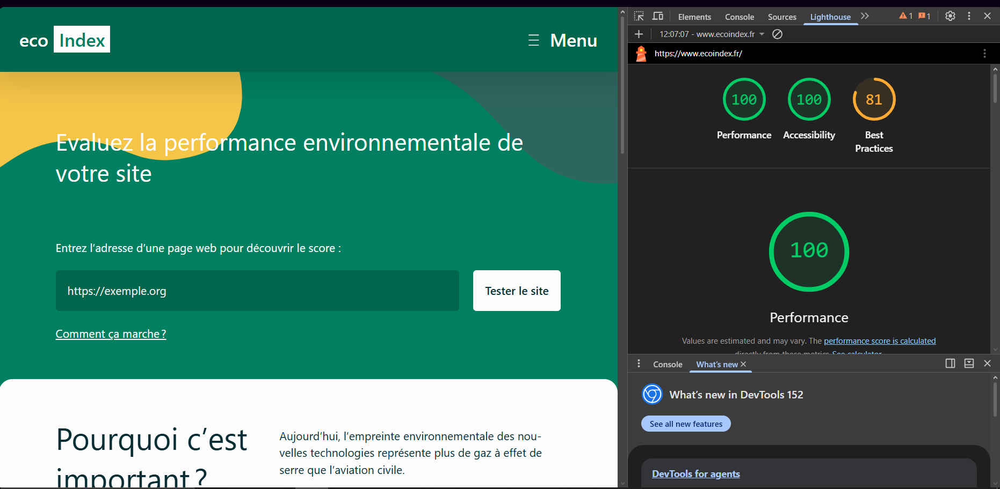
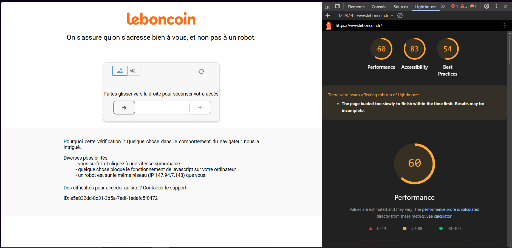
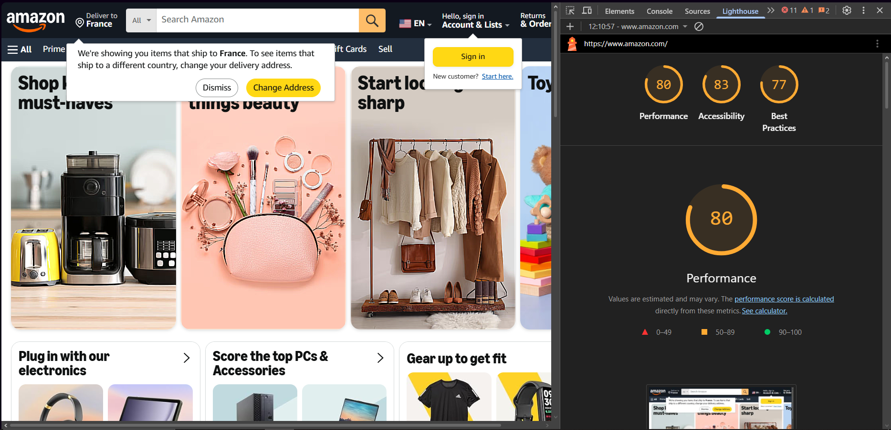

# 2. Mesurer l’impact de services numériques avec EcoIndex

### 1. Parcourir le code des différents projets github du user cnumr, et vérifier que la formule implémentée pour le score EcoIndex est bien celle présentée en cours.

La formule du score EcoIndex dans le site est :

$x = 100 - \frac{3QtilDOM + 2QtilHttp + QtilKo}{6}$

Et celle pour le cours, c'est :

$EcoIndex = 100 - 5 \times \frac{3QtilDOM + 2QtilHttp + QtilKo}{6}$

Donc il y a une différence entres eux.
### 2. Quelle est la formule de calcul de la fonction Quantile(x) ?

$Quantile(x_i) = (n-1) + \frac{x_i-borneInf(n)}{borneSup(n) - borneInf(n)}$


### 3. Quel est le scénario adéquat pour évaluer l’EcoIndex ?


### 4. Récupérer les valeurs des bornes de quantiles, disponible sur le projet cnumr/ecoindex_reference.

```{
  "quantiles": {
    "dom_size": [
0,  47,  75,  159,  233,  298,  358,  417,  476,  537,  603,  674,  753,  843,  949,  1076,  1237,  1459,  1801,  2479,  594601
    ],
    "nb_request": [
0,  2,  15,  25,  34,  42,  49,  56,  63,  70,  78,  86,  95,  105,  117,  130,  147,  170,  205,  281,  3920
    ],
    "response_size": [
0,  1.37,  144.7,  319.53,  479.46,  631.97,  783.38,  937.91,  1098.62,  1265.47,  1448.32,  1648.27,  1876.08,  2142.06,  2465.37,  2866.31,  3401.59,  4155.73,  5400.08,  8037.54,  223212.26
    ]
  },
}
```

### 5. Pour chacune des pages d’accueil des sites suivants, calculer sa valeur d’EcoIndex dans une feuille de calcul. Vérifier à l’aide de l’un des outils qui implémentent l’EcoIndex : ecoindex.fr, leboncoin.fr, amazon.com.





